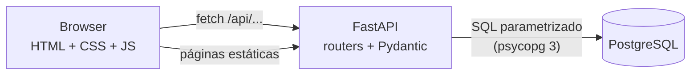
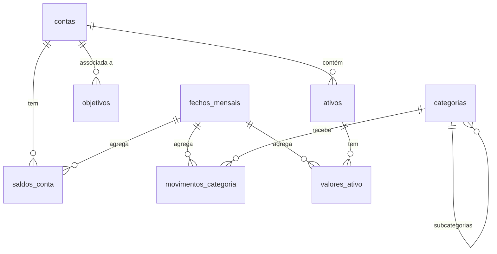

# MyFinance

**Aplicação web de finanças pessoais baseada num fecho mensal.**

No fim de cada mês, o utilizador regista receitas, despesas por categoria, saldos das contas e valores dos investimentos. A partir desses registos, a aplicação calcula o património, a taxa de poupança, o rendimento dos investimentos, o progresso dos objetivos e os relatórios de evolução.

O projeto foi construído sem frameworks no frontend, com o objetivo de mostrar de forma clara cada camada de uma aplicação web completa:

**PostgreSQL** (dados) · **FastAPI** (API em Python) · **HTML, CSS e JavaScript puros** (interface)

> **Estado:** projeto pessoal em desenvolvimento ativo. Ainda **não tem autenticação**, pelo que deve ser executado apenas em `localhost` (ver [Segurança](#segurança) e [Roadmap](#roadmap)).

<!--
Adicionar capturas de ecrã em docs/ e referenciá-las aqui, por exemplo:


-->

---

## Índice

1. [Visão geral](#visão-geral)
2. [Funcionalidades](#funcionalidades)
3. [Conceitos principais](#conceitos-principais)
4. [Arquitetura](#arquitetura)
5. [Modelo de dados](#modelo-de-dados)
6. [Estrutura do projeto](#estrutura-do-projeto)
7. [Instalação e execução](#instalação-e-execução)
8. [Configuração](#configuração)
9. [Utilização: o fecho mensal](#utilização-o-fecho-mensal)
10. [API](#api)
11. [Regras de negócio e validações](#regras-de-negócio-e-validações)
12. [Decisões de design](#decisões-de-design)
13. [Testes](#testes)
14. [Resolução de problemas](#resolução-de-problemas)
15. [Segurança](#segurança)
16. [Roadmap](#roadmap)
17. [Contribuir](#contribuir)
18. [Licença](#licença)

---

## Visão geral

Muitas aplicações de finanças pessoais pedem o registo de cada transação. O MyFinance segue outra abordagem: **uma fotografia por mês**.

1. Ao longo do mês não é preciso registar nada.
2. No fecho, o utilizador preenche um único formulário com os totais do mês.
3. Todas as páginas (dashboard, relatórios, investimentos, objetivos) são **calculadas** a partir desses dados, sem valores duplicados nem estimados.

Isto torna o registo rápido (alguns minutos por mês) e mantém o histórico simples e consistente.

### Princípios

- **Só se guarda o que o utilizador escreve.** Indicadores, gráficos e relatórios são derivados.
- **O histórico é protegido.** Não se apaga nada que tenha dados associados; desativa-se.
- **Sem dependências no frontend.** Sem frameworks, sem bibliotecas de gráficos, sem passo de build.
- **Interface estática.** As páginas cabem no ecrã sem scroll; listas longas rolam dentro do seu cartão.

---

## Funcionalidades

### Páginas

| Página                  | Descrição                                                                                                                                                                                                                                                                                            |
| ----------------------- | ---------------------------------------------------------------------------------------------------------------------------------------------------------------------------------------------------------------------------------------------------------------------------------------------------- |
| **Dashboard**           | Património total, receitas, despesas e taxa de poupança do mês, cada um com a variação face ao mês anterior. Gráfico de evolução do património (anual quando há pelo menos dois anos de dados, mensal caso contrário), distribuição do património por tipo de conta e estado do fundo de emergência. |
| **Contas**              | Criação, edição, ativação/desativação e remoção de contas (conta à ordem, poupança, investimento, reforma). Suporta várias contas do mesmo tipo em instituições diferentes.                                                                                                                          |
| **Despesas**            | Despesas do mês agrupadas por categoria e subcategoria.                                                                                                                                                                                                                                              |
| **Receitas**            | Receitas do mês agrupadas por categoria.                                                                                                                                                                                                                                                             |
| **Investimentos**       | Valor de cada ativo, variação mensal, **rendimento real** (sem contar o dinheiro depositado), rendimento no ano, distribuição por classe de ativo e últimos movimentos.                                                                                                                              |
| **Fundo de Emergência** | Objetivo especial associado a uma conta, com progresso e estimativa de meses em falta.                                                                                                                                                                                                               |
| **Objetivos**           | Metas de poupança com valor alvo, contribuição mensal e previsão de meses restantes.                                                                                                                                                                                                                 |
| **Despesas Anuais**     | Despesas que ocorrem uma vez por ano, com estado previsto/pago e total ainda por pagar.                                                                                                                                                                                                              |
| **Relatórios**          | Quatro separadores: Tendências (evolução do património), Comparativos (receitas vs. despesas, mês atual vs. anterior), Taxa de Poupança e Distribuição.                                                                                                                                              |

### Configuração

| Área                | Descrição                                                                                                                    |
| ------------------- | ---------------------------------------------------------------------------------------------------------------------------- |
| **Geral**           | Dia de início do mês de referência, moeda e idioma.                                                                          |
| **Categorias**      | Criação, edição, ativação/desativação e remoção de categorias e subcategorias, com associação a uma categoria-mãe existente. |
| **Meses fechados**  | Lista de todos os fechos, com possibilidade de **corrigir** ou **apagar** um mês.                                            |
| **Histórico anual** | Registo do património de fim de ano para anos anteriores ao uso da aplicação.                                                |
| **Contas**          | Gestão de contas.                                                                                                            |
| **Ativos**          | Gestão dos ativos de investimento (nome, classe, conta, ativo/inativo).                                                      |

### Fecho do mês

Formulário em pop-up que reúne, num só passo: o período, as receitas e despesas por categoria, os saldos das contas e os valores por ativo (com o valor depositado no mês). Os campos aparecem pré-preenchidos com referências do mês anterior.

---

## Conceitos principais

### Mês de referência

O mês financeiro não coincide necessariamente com o mês do calendário. O período configurado por omissão vai do **dia 27 ao dia 26**. Tudo o que ocorre entre 27/08 e 26/09 pertence a **setembro**.

Cada fecho guarda:

- `data_inicio` e `data_fim`: o período real;
- `mes_referencia`: o dia 1 do mês em que o período **termina** (neste exemplo, `2026-09-01`).

O dia de início é configurável (1 a 28).

### Fecho mensal

Um fecho (`fechos_mensais`) agrega tudo o que foi registado para um mês:

- saldos das contas (`saldos_conta`);
- valores por categoria (`movimentos_categoria`);
- valores por ativo (`valores_ativo`).

Existe no máximo um fecho por mês de referência, e os períodos não podem sobrepor-se.

### Categorias e subcategorias

As categorias têm dois níveis. Exemplo: **Alimentação** → Supermercado, Takeaway/Delivery. Os valores são guardados apenas na **categoria mais baixa** (a que não tem subcategorias); as categorias-mãe somam os valores das filhas.

### Contas e ativos

- **Conta sem ativos:** o saldo é escrito diretamente no fecho.
- **Conta com ativos** (apenas investimento e reforma): o utilizador escreve o valor de cada ativo e o valor depositado nesse mês. O saldo da conta passa a ser a **soma dos ativos**, calculada automaticamente.

O registo por ativo pode começar em qualquer mês. Os meses anteriores mantêm o total da conta; a partir desse mês, o detalhe é por ativo. A aplicação não inventa nem reparte valores do passado.

### Rendimento dos investimentos

```
rendimento do mês = valor neste mês − valor no mês anterior − depositado neste mês
```

- O primeiro registo de um ativo é o **ponto de partida** e não conta como rendimento.
- O rendimento do ano usa como base o último fecho do ano anterior; se não existir, o primeiro fecho do ano corrente.
- Um valor depositado negativo representa um levantamento ou venda.

### Histórico anual do património

Para anos anteriores à utilização da aplicação existe a tabela `patrimonio_historico`, com um valor de património por ano.

- Anos **com** meses fechados usam sempre os fechos (valor do último mês fechado do ano).
- Anos **sem** fechos usam o histórico anual.
- Nos Relatórios, os anos vindos do histórico aparecem a cinzento, porque só existe o total (sem divisão por tipo de conta).

### Fundo de emergência e objetivos

Um objetivo pode estar associado a uma conta. Nesse caso, o valor atual é o **saldo dessa conta** no último fecho, sem nada de novo para preencher. Sem conta associada, usa-se um valor escrito à mão. O fundo de emergência é um objetivo marcado como tal (só pode existir um). Os meses em falta calculam-se como `⌈(alvo − atual) / contribuição mensal⌉`.

---

## Arquitetura



- O **mesmo servidor** (Uvicorn) serve a API em `/api/*` e os ficheiros estáticos do frontend em `/`.
- Cada área funcional tem o seu **router** em `backend/routers/`.
- Cálculos partilhados (indicadores, evolução, distribuição, valor de objetivos) estão em `backend/utils.py`.
- No frontend, cada página tem o seu HTML, CSS e JS. O código comum (pedidos à API, formatação, barra lateral) está em `js/util.js` e `js/sidebar.js`.
- Os gráficos são desenhados em **SVG** (linhas e barras) e **CSS** (`conic-gradient` para os gráficos circulares).

---

## Modelo de dados



### Tabelas

| Tabela                 | Descrição                                    | Colunas principais                                                                                  |
| ---------------------- | -------------------------------------------- | --------------------------------------------------------------------------------------------------- |
| `contas`               | Contas do utilizador                         | `nome`, `instituicao`, `tipo` (`conta_ordem`, `poupanca`, `investimento`, `reforma`), `ativo`       |
| `categorias`           | Categorias e subcategorias                   | `nome`, `tipo` (`despesa`, `receita`), `categoria_pai_id`, `ativo`                                  |
| `fechos_mensais`       | Um registo por mês fechado                   | `mes_referencia` (único, dia 1), `data_inicio`, `data_fim`, `fechado_em`                            |
| `saldos_conta`         | Saldo de cada conta em cada fecho            | `conta_id`, `fecho_id`, `saldo`                                                                     |
| `movimentos_categoria` | Valor de cada categoria em cada fecho        | `categoria_id`, `fecho_id`, `valor` (≥ 0)                                                           |
| `ativos`               | Investimentos dentro de uma conta            | `nome`, `classe` (`etf`, `acao`, `cripto`, `ppr`, `outro`), `conta_id`, `ativo`                     |
| `valores_ativo`        | Valor e depósito de cada ativo em cada fecho | `ativo_id`, `fecho_id`, `valor` (≥ 0), `depositado`                                                 |
| `objetivos`            | Metas de poupança e fundo de emergência      | `nome`, `valor_alvo`, `valor_atual`, `contribuicao_mensal`, `fundo_emergencia`, `conta_id`, `icone` |
| `despesas_anuais`      | Despesas anuais previstas ou pagas           | `data`, `descricao`, `valor`, `pago`                                                                |
| `configuracoes`        | Definições gerais (chave/valor)              | `chave`, `valor`                                                                                    |
| `patrimonio_historico` | Património de fim de ano                     | `ano` (chave), `valor` (≥ 0)                                                                        |

### Restrições de integridade

- `fechos_mensais.mes_referencia` é único e tem de ser o dia 1 de um mês.
- `data_fim >= data_inicio`.
- `saldos_conta`, `movimentos_categoria` e `valores_ativo` são únicos por (entidade, fecho) e apagam-se em cascata com o fecho.
- `fundo_emergencia` tem um índice parcial único: só um objetivo pode ser o fundo de emergência.
- Valores monetários em `NUMERIC(12,2)`.

### Scripts SQL (`database/`)

Os scripts de criação e migração das tabelas estão na pasta `database/`. Todos são idempotentes quando possível (`IF NOT EXISTS`) e devem ser executados com `psql`:

```
\i database/<ficheiro>.sql
```

---

## Estrutura do projeto

```
myfinance/
├── backend/
│   ├── main.py                    # aplicação FastAPI; regista os routers e serve o frontend
│   ├── database.py                # ligação ao PostgreSQL
│   ├── utils.py                   # cálculos partilhados
│   └── routers/
│       ├── ativos.py              # CRUD de ativos
│       ├── categorias.py          # CRUD de categorias e subcategorias
│       ├── configuracao.py        # definições gerais
│       ├── contas.py              # CRUD de contas
│       ├── dashboard.py           # indicadores e gráficos do dashboard
│       ├── despesas.py            # despesas do mês
│       ├── despesas_anuais.py     # despesas anuais
│       ├── fechos.py              # fecho mensal (criar, corrigir, apagar)
│       ├── fundo_emergencia.py    # fundo de emergência
│       ├── investimentos.py       # valores e rendimento por ativo
│       ├── objetivos.py           # objetivos de poupança
│       ├── patrimonio_historico.py# histórico anual do património
│       ├── receitas.py            # receitas do mês
│       └── relatorios.py          # dados dos relatórios
├── frontend/
│   ├── dashboard.html, contas.html, despesas.html, receitas.html,
│   │   investimentos.html, fundo-emergencia.html, objetivos.html,
│   │   despesas-anuais.html, relatorios.html, fecho.html, fechos.html,
│   │   configuracao.html, configuracao-categorias.html,
│   │   configuracao-ativos.html, configuracao-historico.html
│   ├── css/                       # style.css, sidebar.css, componentes.css + um CSS por página
│   └── js/                        # util.js, sidebar.js, fecho.js + um JS por página
├── database/                      # scripts SQL
├── requirements.txt
├── .env                           # não versionado
└── README.md
```

---

## Instalação e execução

### Requisitos

- Python 3.11 ou superior
- PostgreSQL 14 ou superior, em execução
- Git

### 1. Obter o código

```bash
git clone https://github.com/StkaaPa/myfinance.git
cd myfinance
```

### 2. Criar o ambiente virtual e instalar dependências

**Windows (PowerShell)**

```powershell
python -m venv venv
venv\Scripts\activate
pip install -r requirements.txt
```

**Linux / macOS**

```bash
python3 -m venv venv
source venv/bin/activate
pip install -r requirements.txt
```

Dependências principais: `fastapi`, `uvicorn`, `psycopg[binary]`, `python-dotenv`.

### 3. Criar a base de dados

```sql
CREATE DATABASE myfinance;
```

Em seguida, executar os scripts de `database/` na base `myfinance` (com `psql` ou pgAdmin).

### 4. Configurar a palavra-passe

Criar um ficheiro `.env` na raiz do projeto:

```
DB_PASSWORD=palavra_passe_do_postgres
```

### 5. Arrancar a aplicação

A partir da **raiz do projeto**:

```bash
python -m uvicorn backend.main:app --reload
```

Abrir <http://localhost:8000/dashboard.html>.

| Endereço                               | Conteúdo                                 |
| -------------------------------------- | ---------------------------------------- |
| `http://localhost:8000/dashboard.html` | Aplicação                                |
| `http://localhost:8000/docs`           | Documentação interativa da API (Swagger) |
| `http://localhost:8000/api/saude`      | Verificação de estado                    |

> A aplicação deve ser sempre acedida pela porta `8000`. Abrir os ficheiros HTML diretamente ou por outro servidor estático (por exemplo, a extensão Live Server) impede o carregamento do CSS, do JS e da API.

---

## Configuração

| Definição               | Onde                  | Descrição                                                               |
| ----------------------- | --------------------- | ----------------------------------------------------------------------- |
| `DB_PASSWORD`           | `.env`                | Palavra-passe do utilizador PostgreSQL.                                 |
| Ligação à base de dados | `backend/database.py` | Por omissão: `localhost:5432`, base `myfinance`, utilizador `postgres`. |
| Dia de início do mês    | Configuração > Geral  | Dia (1 a 28) em que começa o período de cada fecho. Por omissão, 27.    |
| Moeda e idioma          | Configuração > Geral  | Guardados em `configuracoes`.                                           |

---

## Utilização: o fecho mensal

1. Abrir **Fechar mês** no Dashboard.
2. Confirmar o período (a data de início é sugerida a partir do fecho anterior e do dia configurado).
3. Preencher as **receitas** e **despesas** por categoria (nas subcategorias, quando existem).
4. Preencher o **saldo** de cada conta sem ativos.
5. Para contas com ativos, preencher o **valor** e o **depositado** de cada ativo.
6. Guardar. O Dashboard, os Investimentos, os Objetivos e os Relatórios atualizam-se de imediato.

Um mês já fechado pode ser **corrigido** ou **apagado** em Configuração > Meses fechados.

### Começar a usar com histórico existente

- **Anos anteriores:** registar o património de fim de ano em Configuração > Histórico anual. Aparecem no gráfico do Dashboard e nos Relatórios.
- **Detalhe por ativo:** criar os ativos em Configuração > Ativos e escrever os valores reais a partir do fecho seguinte. Os meses anteriores mantêm o total da conta.

---

## API

Documentação interativa e esquemas completos em `/docs`.

| Recurso                     | Métodos                                             | Descrição                                                    |
| --------------------------- | --------------------------------------------------- | ------------------------------------------------------------ |
| `/api/dashboard`            | `GET`                                               | Indicadores, evolução e distribuição de um mês.              |
| `/api/contas`               | `GET` `POST` `PATCH /{id}` `DELETE /{id}`           | Contas.                                                      |
| `/api/categorias`           | `GET` `POST` `PATCH /{id}` `DELETE /{id}`           | Categorias e subcategorias.                                  |
| `/api/ativos`               | `GET` `POST` `PATCH /{id}` `DELETE /{id}`           | Ativos de investimento.                                      |
| `/api/fechos`               | `GET` `POST` `GET /{id}` `PUT /{id}` `DELETE /{id}` | Fechos mensais.                                              |
| `/api/fechos/formulario`    | `GET`                                               | Dados necessários ao formulário de fecho (novo ou correção). |
| `/api/despesas`             | `GET`                                               | Despesas de um mês.                                          |
| `/api/receitas`             | `GET`                                               | Receitas de um mês.                                          |
| `/api/investimentos`        | `GET`                                               | Valor, variação e rendimento por ativo.                      |
| `/api/fundo-emergencia`     | `GET` `PUT`                                         | Fundo de emergência.                                         |
| `/api/objetivos`            | `GET` `POST` `PATCH /{id}` `DELETE /{id}`           | Objetivos.                                                   |
| `/api/despesas-anuais`      | `GET` `POST` `PATCH /{id}` `DELETE /{id}`           | Despesas anuais.                                             |
| `/api/relatorios`           | `GET`                                               | Dados dos quatro separadores dos relatórios.                 |
| `/api/patrimonio-historico` | `GET` `PUT`                                         | Histórico anual (gravação em lote, tudo ou nada).            |
| `/api/configuracao`         | `GET` `PUT`                                         | Definições gerais.                                           |
| `/api/saude`                | `GET`                                               | Verificação de estado.                                       |

### Convenções

- Dados em JSON; erros no formato `{"detail": "mensagem"}`.
- Códigos usados: `200`/`201`/`204` sucesso, `404` não encontrado, `409` conflito com regras de negócio (por exemplo, apagar algo com histórico), `422` dados inválidos.
- Meses identificados no formato `AAAA-MM`.

---

## Regras de negócio e validações

**Contas**

- Só é possível apagar uma conta sem saldos, ativos nem objetivos associados; caso contrário, desativa-se.
- Uma conta com ativos tem de permanecer do tipo investimento ou reforma.

**Categorias**

- Máximo de dois níveis.
- Os valores guardam-se apenas na categoria mais baixa; uma categoria com valores não pode ter subcategorias.
- O tipo (despesa/receita) não se altera depois da criação.
- Só se apaga uma categoria sem valores nem subcategorias; caso contrário, desativa-se.

**Ativos**

- Só contas de investimento ou reforma podem ter ativos.
- Um ativo com meses fechados não muda de conta nem se apaga; desativa-se.
- Não existem dois ativos ativos com o mesmo nome na mesma conta.
- Um ativo desativado deixa de ser pedido nos novos fechos; o histórico mantém-se.

**Fechos**

- Um fecho por mês de referência, sem sobreposição de períodos.
- O mês de referência tem de coincidir com o mês em que o período termina.
- Contas com ativos não levam saldo próprio: o saldo é a soma dos ativos.
- Num fecho novo, todos os ativos ativos têm de ter valor.

**Histórico anual**

- Um valor por ano (≥ 0, até 2 casas decimais).
- Anos com meses fechados não aceitam valor manual.

**Geral**

- Valores monetários com um máximo de 2 casas decimais; no ecrã aceitam-se `52,30` e `52.3`.
- Operações destrutivas pedem confirmação com um segundo clique.
- Todo o SQL é parametrizado; os nomes de colunas em atualizações dinâmicas vêm de listas fixas, nunca do cliente.

---

## Decisões de design

- **Porquê um fecho mensal e não transações?** Reduz o esforço de registo e mantém o histórico simples. O objetivo é perceber a evolução global, não auditar cada movimento.
- **Porquê FastAPI?** Validação de dados com Pydantic, documentação automática e código curto, mantendo tudo em Python.
- **Porquê JavaScript puro?** Mostra de forma explícita como o frontend comunica com a API e evita dependências e passos de build.
- **Porquê gráficos em SVG e CSS?** Dependem apenas do browser, são leves e fáceis de ajustar ao estilo da aplicação.
- **Porquê `NUMERIC(12,2)`?** Evita erros de arredondamento de números de vírgula flutuante em valores monetários.
- **Porquê desativar em vez de apagar?** Preserva o histórico e a coerência dos meses já fechados.
- **Porquê servir o frontend pelo FastAPI?** Uma só porta e um só processo, sem problemas de CORS.

---

## Testes

Atualmente os testes são manuais e semiautomáticos:

- **API:** pedidos com `curl` (ou pela interface `/docs`), incluindo casos de erro (valores negativos, anos repetidos, conflitos com histórico).
- **Interface:** scripts Playwright que percorrem as páginas, verificam a ausência de scroll a 1280×720 e a ausência de erros na consola do browser.

A criação de uma suite `pytest` para a API está prevista no [Roadmap](#roadmap).

---

## Resolução de problemas

| Sintoma                                               | Causa provável                                                    | Solução                                                                    |
| ----------------------------------------------------- | ----------------------------------------------------------------- | -------------------------------------------------------------------------- |
| Página sem estilo ou a barra lateral não aparece      | A página foi aberta fora da porta 8000 (por exemplo, Live Server) | Aceder por `http://localhost:8000/...`                                     |
| `Error loading ASGI app` ou `No module named backend` | Comando executado dentro de `backend/`                            | Executar na raiz do projeto: `python -m uvicorn backend.main:app --reload` |
| `uvicorn` não reconhecido                             | Ambiente virtual não ativo                                        | Ativar o `venv` ou usar `python -m uvicorn`                                |
| `KeyError: 'DB_PASSWORD'`                             | Falta o ficheiro `.env` ou a variável                             | Criar `.env` na raiz com `DB_PASSWORD=...`                                 |
| `password authentication failed`                      | Palavra-passe errada                                              | Corrigir `DB_PASSWORD`                                                     |
| `relation "..." does not exist`                       | Falta executar um script de `database/`                           | Executar os scripts SQL em falta                                           |
| Alterações no frontend não aparecem                   | Cache do browser                                                  | Atualizar com `Ctrl+F5`                                                    |

---

## Segurança

- A aplicação **não tem autenticação nem autorização**. Qualquer pessoa com acesso à porta pode ler e alterar os dados. Deve ser executada apenas em `localhost` ou numa rede de confiança.
- O ficheiro `.env` contém credenciais e **não deve ser versionado**. Exemplo de `.gitignore`:

  ```
  .env
  venv/
  __pycache__/
  *.pyc
  ```

- O acesso à base de dados usa SQL parametrizado e validação de entrada com Pydantic.
- Recomenda-se fazer cópias de segurança regulares enquanto não existir exportação na aplicação:

  ```bash
  pg_dump -U postgres myfinance > backup.sql
  ```

---

## Licença

Ver o ficheiro [LICENSE](#license)
